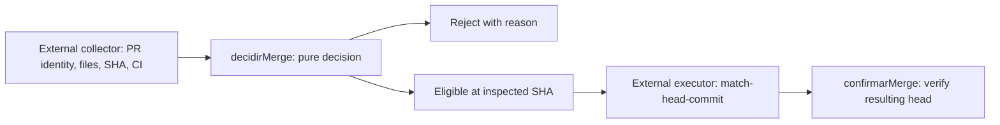

# Agent Merge Guard

Dependency-free decision functions for reviewing agent-created pull requests.
A prompt is not an enforcement boundary: merge eligibility is decided from
explicit facts, with merge disabled by default.

**Node.js 22.12+ · JavaScript ESM · 21 tests · MIT**

## Quick start

```bash
git clone https://github.com/TheLionGab/agent-merge-guard.git
cd agent-merge-guard
npm test
```

No installation, network access, GitHub account, or model is needed to run tests.

## Architecture



The collector and executor are outside this repository. The library provides:

- [`decidirMerge`](src/merge-gate.mjs): checks repository, PR number, author,
  branch, fork origin, state, base, draft status, explicit opt-in, identical
  before/after SHAs, complete file pagination, path allowlist, and successful CI.
- `caminhoOk`: checks both sides of a rename and rejects `..` paths.
- `comandoMerge`: formats a SHA-bound `gh pr merge` command after validating inputs;
  it does not execute it.
- `confirmarMerge`: reports a merge whose resulting head differs from the inspected head.
- [`dado`](src/untrusted.mjs): normalizes untrusted text, removes invisible
  formatting characters, and escapes angle brackets inside a labeled data block.

## Example

```js
import { caminhoOk, comandoMerge } from './src/merge-gate.mjs';

caminhoOk({ caminho: 'docs/README.md' }, [/^docs\//]); // true
caminhoOk({ caminho: 'docs/README.md', anterior: 'src/auth.js' }, [/^docs\//]); // false
comandoMerge('owner/repo', 12, 'a'.repeat(40));
// gh pr merge 12 --repo owner/repo --squash --match-head-commit aaaa… (40 hex characters)
```

See [`test/merge-gate.test.mjs`](test/merge-gate.test.mjs) for a complete inspection fixture.

## Engineering Decisions & Test Strategy

| Incorrect implementation | Decision | Regression evidence |
| --- | --- | --- |
| Trust CI while a push changes the inspected head. | Require identical valid SHAs before and after inspection; bind the eventual command to that SHA. | The before/after SHA mismatch test rejects the PR. |
| Rename a sensitive file into an allowed documentation path. | Apply the allowlist to both old and new paths. | The rename test starts outside the allowlist and must fail. |
| Accept a fork because its branch name matches. | Verify repository, PR, author, and head origin. | Identity tests reject forks and mismatched identities. |
| Let hostile text close its data delimiter. | Normalize Unicode and escape every angle bracket. | [`test/untrusted.test.mjs`](test/untrusted.test.mjs) covers zero-width and full-width attacks. |

`npm test` runs all 21 cases offline. CI runs the same suite on Node 22.
The original project documentation records manual mutation checks; no
mutation runner is included, so those checks are not claimed as CI coverage.

## Scope and limitations

Extracted from a private agent workflow; this is its reusable decision core.
It does not collect GitHub facts, run agents, execute commands, or grant permissions.
Its caller must provide trustworthy, complete observations and a suitable allowlist.
A data delimiter helps structure a prompt; it does not guarantee resistance to prompt injection.
